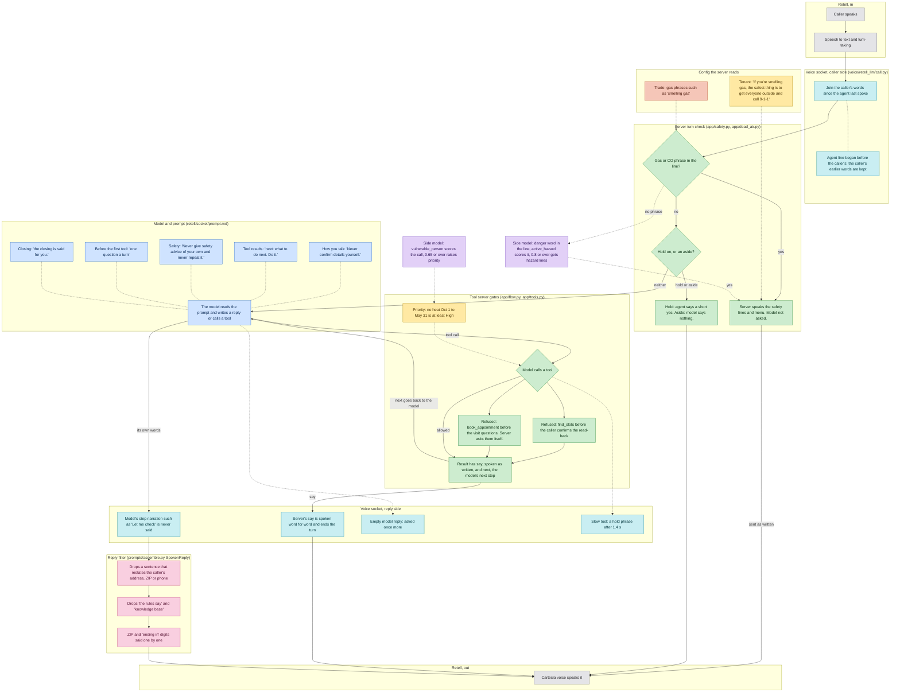
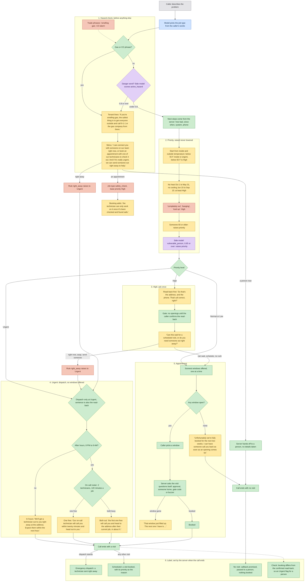

# Where Brian's rules live

Each color is one layer: what the model is told (the prompt), what the server decides in code, what sits in company and trade config, the side model, and what the voice socket and the reply filter do on the way in and out. Built from the code at the commit that added this page; the files named in each box are the source.

## One caller line, every layer

A caller line goes through the voice socket and the server first; the model only sees it if no safety line or hold takes it, and the server's own sentences (say) override the model's words.

## If-then decisions on a no-heat or gas call

The server walks this tree on every call; the quoted lines are word for word from the tenant config, and the model says them as written.

## Legend

| Layer | Where it lives | Example |
|---|---|---|
| Prompt (blue) | `retell/socket/prompt.md` | "Never give safety advice of your own and never repeat it." |
| Server code (green) | `app/flow.py`, `tools.py`, `priority.py`, `safety.py`, `dead_air.py`, `consistency.py`, `labels.py` | find_slots is refused until the caller confirms the read-back. |
| Tenant config (yellow) | `tenants/summit-air/agent.yaml`, `config.yaml` | Heating season Oct 1 to May 31; on call: 2 technicians, 120 minutes a job. |
| Trade config (terracotta) | `trades/hvac/agent.yaml` | "completely out" raises a no-heat call to High. |
| Side model (purple) | `prompts/side/questions.yaml`, `app/side_model.py` | vulnerable_person at 0.65 or over raises priority. |
| Voice socket (teal) | `voice/retell_llm/call.py`, `llm_socket.py` | Caller words spoken over the end of the agent's line are kept. |
| Reply filter (pink) | `prompts/assemble.py` (SpokenReply) | ZIP digits and "ending in" digits are said one by one. |
| Retell and caller (gray) | Outside this repo | Speech to text, turn-taking, Cartesia voice. |
